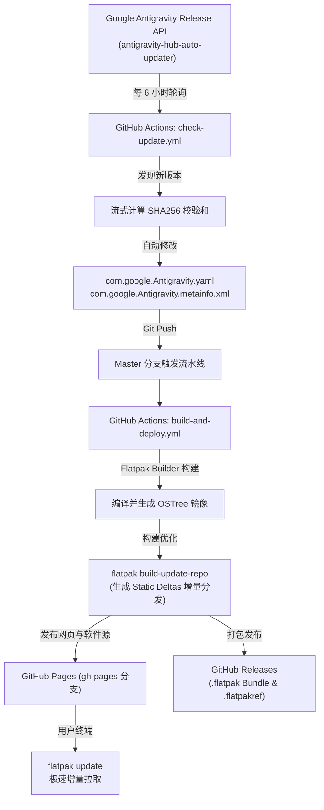

# Antigravity Flatpak

<div align="center">
  
  <h3>Google Antigravity IDE — 生产级 Flatpak 打包与全自动更新项目</h3>
  <p>
    <a href="https://github.com/jhuang6451/antigravity-flatpak/actions/workflows/build-and-deploy.yml"></a>
    <a href="https://github.com/jhuang6451/antigravity-flatpak/actions/workflows/check-update.yml"></a>
    <a href="https://github.com/jhuang6451/antigravity-flatpak/releases/latest"></a>
    
    
    <a href="LICENSE"></a>
  </p>
  <p>
    <b><a href="https://jhuang6451.github.io/antigravity-flatpak/">🌐 在线仓库主页与一键安装</a></b>
  </p>
</div>

---

## 📖 项目简介 (Overview)

本仓库提供 Google 下一代智能体编程集成开发环境 **Antigravity IDE** 的生产级 Flatpak 打包方案。

针对主流 Linux 系统（Fedora Silverblue/Atomic、Ubuntu、Debian、Arch Linux、openSUSE、SteamOS 等），本项目实现了：
1. **一键安装**：配置专有 OSTree 仓库，用户单条命令即可完成安全部署。
2. **自动化更新**：CI 持续监控 Google 官方分发端，新版本发布时自动校验并推送差异补丁，终端运行 `flatpak update` 即可无缝升级。
3. **原生环境与硬件加速**：内置自适应 Wayland/X11 支持、完整 GPU 硬件加速、PipeWire 屏幕录制集成以及沙箱内外部工作区深度互通。

---

## 🚀 快速安装 (Quick Start)

### 方式 1：添加仓库一键安装（推荐，支持全自动日常更新）

直接在终端执行以下命令：

```bash
# 1. 添加 Antigravity 软件源仓库
flatpak remote-add --if-not-exists antigravity https://jhuang6451.github.io/antigravity-flatpak/antigravity.flatpakrepo

# 2. 安装 Antigravity IDE
flatpak install -y antigravity com.google.Antigravity

# 3. 运行应用
flatpak run com.google.Antigravity
```

安装完成后，可以在桌面启动器（GNOME、KDE Plasma、XFCE 等）的应用列表中直接找到 **Antigravity** 点击运行。

---

### 方式 2：使用 `.flatpakref` 单文件图形化安装

1. 访问在线页面 [https://jhuang6451.github.io/antigravity-flatpak/](https://jhuang6451.github.io/antigravity-flatpak/) 点击 **一键安装** 按钮，或在 [Releases](https://github.com/jhuang6451/antigravity-flatpak/releases/latest) 下载 `antigravity.flatpakref`。
2. 双击通过系统应用商店（GNOME Software 或 KDE Discover）一键安装，或在终端执行：
   ```bash
   flatpak install antigravity.flatpakref
   ```

---

### 方式 3：离线单文件 Bundle 安装

对于无外网或特定局域网环境，可直接前往 [Releases 页面](https://github.com/jhuang6451/antigravity-flatpak/releases/latest) 下载打包好的 `com.google.Antigravity.flatpak` 单文件安装包：

```bash
flatpak install com.google.Antigravity.flatpak
```

---

## 🔄 软件日常更新 (Updates)

由于配置了官方标准 Flatpak 仓库，后续所有的版本迭代均可跟随系统更新或执行单条指令完成：

```bash
# 更新 Antigravity 到最新版
flatpak update com.google.Antigravity

# 或随系统所有 Flatpak 应用批量更新
flatpak update
```

---

## ⚙️ 自动化流水线架构 (Automation Architecture)

本项目采用全自动化生产级 CI/CD 流水线，实现了免人工维护的端到端持续交付：



### 自动化组件说明：
- **`scripts/update-checker.py`**：精确解析 Google Auto-Updater 的 Releases JSON 列表，提取最新构建的 `version` 与 `execution_id`，流式下载并校验散列值。
- **`.github/workflows/check-update.yml`**：基于 GitHub Actions 定时任务（Cron）自动调度检查器并自动提交 Manifest。
- **`.github/workflows/build-and-deploy.yml`**：调用 Flathub 标准环境打包构建，利用 GitHub Cache 缓存 OSTree 历史对象，部署静态增量仓库到 GitHub Pages，并同步发布 Standalone Bundle 资产。

---

## 🛠️ 关键技术细节与特质 (Key Engineering Highlights)

1. **Google GRTE 解释器修正 (Glibc Interp Patch)**：
   - 上游发布的二进制包中，`resources/bin/webm_encoder` 默认硬编码指向 Google 内部基础设施专用的动态链接器路径 `/usr/grte/v5/lib64/ld-linux-x86-64.so.2`，这在标准 Linux 发行版与 Flatpak 容器中会导致 `No such file or directory` 错误而无法启动屏幕录制/编码。
   - 本项目在打包指令中内建了无损二进制动态链接器修正逻辑，将其无缝定向至容器标准路径 `/lib64/ld-linux-x86-64.so.2`，彻底解决潜在崩溃问题。

2. **Chromium / Electron 沙箱集成 (Zypak Integration)**：
   - 依赖 `org.electronjs.Electron2.BaseApp` 运行时底座，通过 `zypak-wrapper` 替代传统的 setuid `chrome-sandbox`，在无特权 Flatpak 容器中实现完整的 Chromium 多进程安全沙箱隔离。

3. **Wayland 与显示环境适配**：
   - 启动脚本 `antigravity.sh` 自动感知当前会话类型。在 Wayland 环境下自适应注入 `--ozone-platform-hint=auto` 与 `--enable-features=WaylandWindowDecorations`。
   - 支持通过用户级配置文件 `~/.config/antigravity-flags.conf` 自由扩展 Electron 参数（例如自定义输入法支持、GPU 黑名单覆写等）。

4. **开发者工作区权限设计**：
   - 赋予 `--filesystem=host` 权限，确保 Antigravity 作为 Agentic IDE 能够自由读取、索引和编辑用户本地文件系统的开发项目。
   - 开放 `--socket=ssh-auth`、`--socket=pulseaudio` 与 `--filesystem=xdg-run/pipewire-0`，保障远程开发通信及音画多模态交互。

---

## 💻 本地开发与测试 (Local Development)

如果需要在本地构建和调试此 Flatpak 包：

### 1. 检查或强制更新版本
```bash
# 仅检查是否有上游更新
python3 scripts/update-checker.py --check

# 强制重新计算 SHA256 并更新 Manifest
python3 scripts/update-checker.py --force --update
```

### 2. 本地一键构建与安装
```bash
# 运行本地构建脚本（自动处理依赖与构建环境）
./scripts/build-local.sh
```

---

## 📁 目录结构 (Repository Structure)

```text
flatpak-agy/
├── .github/
│   └── workflows/
│       ├── check-update.yml          # 定时监控上游版本的自动化工作流
│       └── build-and-deploy.yml      # 打包、发布 OSTree 仓库与 Releases 的工作流
├── icons/                            # 各分辨率 Hicolor 图标集合
│   └── hicolor/
│       ├── 16x16/apps/...
│       ├── ...
│       └── 512x512/apps/com.google.Antigravity.png
├── scripts/
│   ├── update-checker.py             # 上游版本探测与 Manifest 自动更新脚本
│   └── build-local.sh                # 本地构建与打包脚本
├── web/
│   ├── index.html                    # GitHub Pages 静态安装主页
│   └── style.css                     # 页面样式文件
├── antigravity.flatpakref            # Flatpak 单文件安装描述符
├── antigravity.flatpakrepo           # Flatpak 软件源远程定义文件
├── antigravity.sh                    # 桌面启动与参数适配包装脚本
├── com.google.Antigravity.desktop    # 遵循 FreeDesktop 规范的桌面文件
├── com.google.Antigravity.metainfo.xml# AppStream 规范的软件描述与版本历史元数据
├── com.google.Antigravity.yaml       # 核心 Flatpak Manifest 定义文件
├── .gitignore
├── LICENSE
└── README.md
```

---

## 📄 许可证与版权说明 (License & Disclaimer)

- 本仓库的打包脚本、配置文件与构建脚本基于 [MIT License](LICENSE) 授权开源。
- **Antigravity** 及其标志、二进制程序的知识产权及版权归 Google LLC 所有。
- 本项目为独立社区维护的自动化打包分发方案，旨在为广大 Linux 用户提供便捷的 Flatpak 交付体验。
